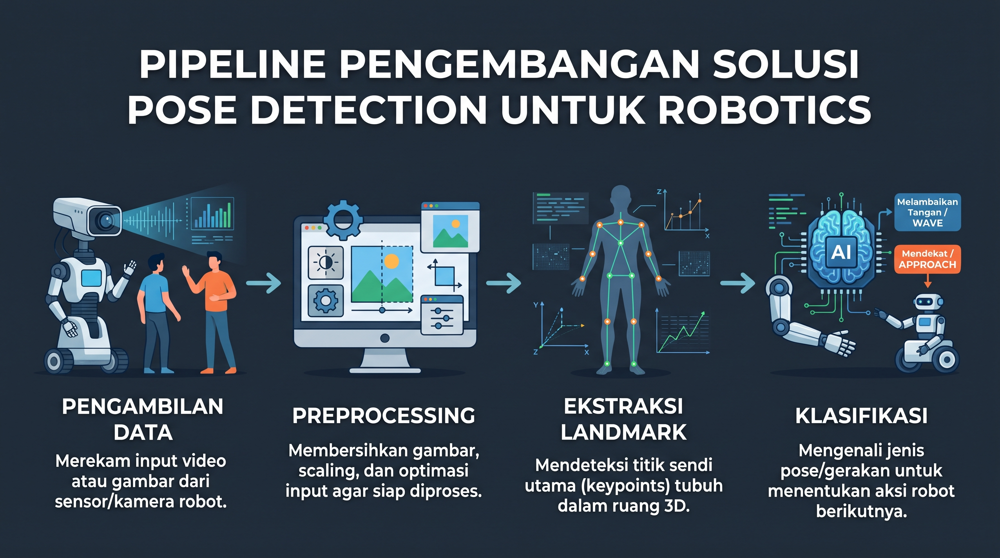

# Chapter 2: Pose Detection

Secara sederhana, **Pose Detection** adalah teknologi yang memungkinkan komputer atau robot mengenali posisi titik-titik sendi utama pada tubuh manusia dari tangkapan kamera untuk kemudian merangkainya menjadi kerangka tubuh digital. Dalam mempelajari _Human-Robot Interaction_ (HRI), pemahaman tentang teknologi ini sangat krusial karena menjadi "mata" bagi robot untuk mengetahui keberadaan serta gerakan manusia di sekitarnya secara alami, tanpa perlu memasang sensor fisik tambahan di tubuh pengguna. Menguasai teori dan cara kerja teknis di baliknya mulai dari bagaimana piksel gambar diubah menjadi angka koordinat hingga faktor yang memengaruhi akurasinya. Pengetahuan ini akan membantu kamu tidak sekadar memakai library siap pakai, tetapi juga mampu merancang sistem persepsi yang responsif, tepat sasaran, dan aman saat dihubungkan langsung ke robot.

Di chapter ini, kamu akan belajar:
1. [Konsep Dasar Representasi Visual dalam Computer Vision](#21-konsep-dasar-representasi-visual-dalam-computer-vision)
2. [Pipeline Pengembangan Model Pose Detection dengan MediaPipe](#22-pipeline-pengembangan-model-pose-detection-dengan-mediapipe)
3. Praktek Melatih Model Pose Detection

## 2.1: Konsep Dasar Representasi Visual dalam Computer Vision

Saat melihat sebuah foto, mata dan otak manusia bisa secara instan menangkap makna secara utuh. Misal, kita langsung tahu bahwa di dalam gambar tersebut ada seseorang yang sedang melambaikan tangan di depan meja. Sebaliknya, komputer tidak mengenal konsep "manusia" maupun "tangan". Bagi mesin, sebuah gambar hanyalah susunan kotak-kotak mikroskopis bernama **piksel**, di mana setiap kotaknya berisi deretan angka yang mewakili intensitas warna. Perbedaan mendasar inilah yang menjadi tantangan utama dalam *Computer Vision*: bagaimana caranya mengubah lautan matriks angka mentah tersebut menjadi informasi spasial yang bermakna agar robot bisa mengenali keberadaan dan posisi tubuh manusia.

Untuk mewakili warna pada setiap piksel, komputer umumnya menggunakan model **RGB** yang terdiri dari tiga saluran (*channel*) warna dasar: **Red** (Merah), **Green** (Hijau), dan **Blue** (Biru). Masing-masing *channel* ini menyimpan nilai intensitas dari angka **0** (gelap total) hingga **255** (terang maksimal), dan seluruh jutaan variasi warna yang muncul di layar sebenarnya hanyalah hasil kombinasi angka dari ketiga *channel* tersebut. Sebagai contoh, satu piksel dengan kombinasi nilai `(255, 0, 0)` akan tampil sebagai warna merah murni, sedangkan jika *channel* Merah dan Hijau dicampur secara maksimal menjadi `(255, 255, 0)`, warna yang tercipta di layar adalah kuning terang.

> **TIPS!** \
> Coba [W3Schools Color Picker](https://www.w3schools.com/colors/colors_picker.asp) untuk eksplorasi kombinasi warna RGB.

Untuk menentukan posisi setiap piksel maupun titik sendi di dalam gambar, komputer menggunakan sistem koordinat yang sedikit berbeda dari grafik matematika biasa. Titik pusat `(0, 0)` selalu berada di **pojok kiri atas** layar, di mana nilai sumbu **X** bertambah ke arah kanan dan sumbu **Y** bertambah ke arah bawah. Pemetaan posisi yang hanya mengandalkan dua sumbu datar ini disebut **representasi ruang 2D `(x, y)`**, yang ibaratnya menandai lokasi objek di atas selembar kertas foto. Namun, karena robot beroperasi di dunia nyata yang memiliki jarak dan volume, peta datar saja sering kali belum cukup. Oleh sebab itu, sistem *Pose Detection* modern juga menghasilkan **representasi ruang 3D `(x, y, z)`** dengan menambahkan sumbu **Z** sebagai estimasi kedalaman (*depth*) yang menunjukkan seberapa dekat atau jauh posisi suatu titik sendi terhadap kamera maupun pusat tubuh manusia.

*Sumber: Ilustrasi dibuat menggunakan AI*

Untuk mengenali keberadaan suatu benda di dalam gambar, algoritma *Computer Vision* dilatih untuk memindai pola perubahan nilai piksel, seperti garis tepi, sudut, dan tekstur warna, yang membentuk ciri khas objek tertentu. Ketika sekumpulan piksel berhasil dikenali sebagai satu kesatuan objek, metode **Object Detection** akan mengelompokkannya ke dalam sebuah kotak persegi imajiner bernama **bounding box**. Meskipun efektif untuk mendeteksi keberadaan dan posisi kasar suatu objek, *bounding box* memiliki keterbatasan besar dalam konteks HRI karena hanya mampu memberi tahu robot bahwa *"di dalam kotak ini ada manusia"*. Ia sama sekali tidak bisa menjelaskan detail posisi anggota tubuh di dalamnya, seperti apakah orang tersebut sedang melambaikan tangan, menunjuk arah, atau terjatuh.

*Sumber: [PeopleforAI](https://www.peopleforai.com/glossary/bounding-box/)*

Untuk mengatasi keterbatasan *bounding box* dan memetakan posisi anggota tubuh secara detail, algoritma *Pose Detection* umumnya bekerja menggunakan dua strategi utama: **Top-Down** dan **Bottom-Up**. Pada pendekatan **Top-Down**, komputer tetap memanfaatkan *Object Detection* di tahap awal untuk menandai setiap manusia dengan *bounding box*, lalu memfokuskan pencarian titik-titik sendi (*keypoints*) hanya di dalam masing-masing kotak tersebut. Sebaliknya, pendekatan **Bottom-Up** langsung memindai seluruh gambar untuk mendeteksi semua titik sendi yang terlihat tanpa membuat *bounding box* terlebih dahulu, baru kemudian "menjahit" dan mengelompokkan titik-titik sendi tersebut menjadi kerangka tubuh utuh untuk tiap individu.

Ada beberapa istilah teknis dasar yang akan sangat penting. Pertama adalah **frame**, yaitu satu tangkapan gambar diam tunggal yang diambil dari aliran video kamera—secara teknis, tayangan video *real-time* hanyalah deretan *frame* yang diputar cepat secara berurutan (kecepatannya diukur dalam *Frames Per Second* atau FPS). Kedua adalah **landmark** (sering juga disebut *keypoint*), yakni titik koordinat spesifik yang menandai lokasi anatomis penting pada tubuh, seperti tengah bahu, sendi siku, hingga pergelangan tangan. Ketika titik-titik *landmark* ini dihubungkan oleh garis imajiner, terbentuklah **skeleton** atau kerangka tubuh digital yang memudahkan kita memvisualisasikan postur manusia di layar. Terakhir, koordinat *landmark* ini umumnya disajikan dalam skala **ternormalisasi** (rentang angka **0.0 hingga 1.0** terhadap lebar dan tinggi *frame*), sehingga posisi sendi tetap konsisten terbaca meskipun ukuran layar atau resolusi kamera yang digunakan berbeda-beda.

Dalam praktiknya, tangkapan kamera tidak selalu sempurna. Terkadang, ada bagian tubuh manusia bisa saja tertutup benda lain (*occlusion*), buram akibat gerakan cepat, atau berada di pencahayaan redup. Pada kondisi seperti ini, model *Pose Detection* memiliki keterbatasan ketidakyakinan dalam menebak posisi sendi yang sebenarnya. Untuk mengatasinya, setiap titik sendi yang dihasilkan selalu dilengkapi dengan **confidence score** (atau *visibility score*) berupa nilai probabilitas dari **0.0 hingga 1.0**, yang memungkinkan program kita menyaring dan mengabaikan titik-titik yang tebakannya kurang meyakinkan. Dengan memahami seluruh rangkaian ini kamu kini sudah memiliki fondasi lengkap tentang bagaimana data visual mentah diubah menjadi kerangka tubuh digital yang siap diolah lebih lanjut.

## 2.2 Pipeline Pengembangan Model Pose Detection dengan MediaPipe

*Sumber: [MediaPipe](https://mediapipe.readthedocs.io/en/latest/solutions/face_mesh.html)*

Dalam praktiknya, kita tidak perlu membangun dan melatih model kecerdasan buatan dari nol untuk mengenali tubuh manusia. Saat ini, sudah tersedia berbagai model siap pakai (*pre-trained models*), seperti OpenPose, YOLO-Pose, hingga MediaPipe. Di antara pilihan tersebut, **MediaPipe** buatan Google menjadi salah satu alat yang paling sering digunakan dalam permasalahan *Pose Detection*. Popularitasnya didorong oleh arsitekturnya yang sangat ringan dan efisien, sehingga mampu berjalan secara *real-time* hanya menggunakan CPU laptop biasa tanpa membutuhkan GPU berdaya besar. Sekali memproses satu *frame* gambar, **MediaPipe Pose** dapat memetakan hingga **33 titik sendi tubuh (*landmarks*)** secara detail yang mencakup area wajah (hidung, mata, telinga, mulut), tubuh bagian atas (bahu, siku, pergelangan tangan, hingga pangkal jari), serta tubuh bagian bawah (pinggul, lutut, pergelangan kaki, tumit, dan ujung jari kaki).

*Sumber: Ilustrasi dibuat menggunakan AI*

Secara keseluruhan, *pipeline* deteksi pose dengan MediaPipe dimulai dari tahap **pengambilan data**, di mana kamera menangkap aliran video secara *real-time* sebagai deretan *frame* gambar. Sebelum masuk ke MediaPipe, setiap *frame* melewati tahap **pre-processing**, seperti:
- mengubah format warna bawaan *library* kamera (umumnya BGR pada OpenCV) menjadi format **RGB** sesuai standar input MediaPipe, serta
- menyesuaikan ukuran (*resizing*) dan normalisasi nilai piksel agar proses komputasi berjalan ringan. 

Selanjutnya, *frame* yang telah siap diproses oleh arsitektur MediaPipe untuk menghasilkan **ekstraksi 33 titik *landmark*** berupa deretan angka koordinat `(x, y, z)` beserta nilai *visibility*-nya. Kumpulan data numerik inilah yang kemudian dimanfaatkan pada tahap akhir untuk mengenali dan mengklasifikasikan jenis gerakan, baik menggunakan pendekatan **rule-based** berbasis aturan logika posisi sendi maupun digunakan sebagai data latih untuk model *machine learning* sederhana seperti *Decision Tree* atau *Random Forest*.

Agar hasil deteksi pose tetap stabil dan akurat saat diuji langsung pada robot, ada beberapa pengaturan parameter serta batasan teknis MediaPipe yang perlu kamu perhatikan:

* **Model Complexity (`0`, `1`, atau `2`):** Mengatur tingkat kerumitan model yang digunakan di mana semakin tinggi angkanya, estimasi titik sendi semakin akurat, tetapi beban komputasinya lebih berat sehingga kecepatan *frame* bisa menurun.
* **Min Detection Confidence (`0.0 – 1.0`):** Ambang batas keyakinan minimal agar kemunculan manusia di awal dianggap valid. Jika dipasang terlalu rendah, sistem mudah salah mengenali benda di sekitar sebagai tubuh manusia.
* **Min Tracking Confidence (`0.0 – 1.0`):** Ambang batas keyakinan untuk terus melacak pergerakan sendi antar-*frame* tanpa memicu ulang deteksi awal; jika keyakinan model turun di bawah batas ini, sistem otomatis mencari ulang posisi tubuh dari awal.
* **Fokus Satu Subjek (*Single-Person*):** MediaPipe Pose standar hanya dirancang untuk melacak satu orang utama di depan kamera, sehingga target pelacakan bisa berpindah-pindah jika ada banyak orang lalu-lalang di latar belakang.
* **Sensitif terhadap *Occlusion* dan Pencahayaan:** Akurasi tebakan posisi sendi akan menurun drastis apabila bagian tubuh tertutup objek lain, berada di ruangan redup, atau membelakangi sumber cahaya yang terlalu terang.

## 2.3: Praktek Melatih Model Pose Detection

Setelah memahami bagaimana tangkapan kamera diubah menjadi deretan angka koordinat landmark oleh MediaPipe, sekarang saatnya kamu melihat dan menguji cara kerjanya secara langsung. 

> **LET'S MOVE ON!** \
> Buka [Hands-On](module.ipynb) di Google Colab